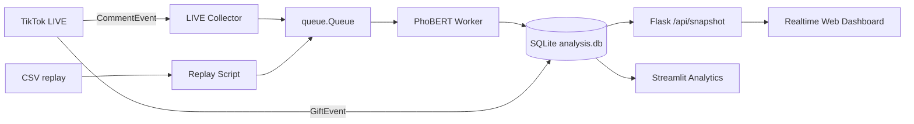

# ViRDC SQLite Realtime — Phát hiện phân biệt vùng miền tiếng Việt

<div align="center">


**Thu thập bình luận TikTok LIVE, phân loại realtime bằng PhoBERT và lưu kết quả vào một file SQLite — không cần Kafka hoặc Docker.**

</div>

---

## Mục lục

- [Tổng quan](#tong-quan)
- [Tính năng](#tinh-nang)
- [Kiến trúc hệ thống](#kien-truc)
- [Yêu cầu](#yeu-cau)
- [Cài đặt nhanh](#cai-dat)
- [Chuẩn bị model](#model)
- [Cách sử dụng](#su-dung)
- [Cấu hình](#cau-hinh)
- [SQLite và API](#sqlite-api)
- [Cấu trúc dự án](#cau-truc)
- [Kiểm thử](#kiem-thu)
- [Giới hạn](#gioi-han)
- [Xử lý lỗi](#xu-ly-loi)
- [Nguồn tham khảo và giấy phép](#giay-phep)

---

<a id="tong-quan"></a>
## Tổng quan

Dự án xây dựng một pipeline nhỏ gọn cho bài tập hoặc đồ án môn học:

1. Nhận bình luận realtime từ một phiên **TikTok LIVE**.
2. Chuẩn hóa tiếng Việt và chạy suy luận bằng model PhoBERT đã fine-tune.
3. Dự đoán một trong ba nhãn: `khác`, `ủng hộ`, `phân biệt`.
4. Lưu bình luận, tài khoản, confidence, latency và toàn bộ event JSON vào SQLite.
5. Hiển thị lịch sử và kết quả phân tích trên dashboard web.

Model được load một lần và chạy trên một worker nền. Collector chỉ đưa event vào
`queue.Queue`, vì vậy callback TikTok không phải chờ quá trình suy luận. SQLite bật
WAL để dashboard có thể đọc dữ liệu trong lúc worker đang ghi.

<a id="tinh-nang"></a>
## Tính năng

- **TikTok LIVE realtime:** nhận `CommentEvent` và `GiftEvent` bằng `TikTokLive`.
- **PhoBERT ba lớp:** trả về nhãn, confidence, xác suất từng lớp và cờ `is_discrimination`.
- **SQLite chống trùng:** UPSERT theo `comment_id`; mỗi bình luận chỉ có một bản ghi hiện hành.
- **Web dashboard nhiều trang:** tổng quan, feed realtime, phân tích và tra cứu dữ liệu.
- **Thống kê phiên LIVE:** nhãn, confidence, latency, biểu đồ theo giờ, top tài khoản và quà tặng.
- **Lọc và xuất dữ liệu:** tìm theo nội dung/tài khoản, lọc nhãn/confidence, phân trang và xuất CSV UTF-8.
- **Dashboard tổng hợp:** Streamlit hiển thị số lượng, tỷ lệ, latency và phân bố nhãn.
- **Chạy thử bằng CSV:** replay dữ liệu có sẵn khi không có tài khoản đang LIVE.
- **Pipeline huấn luyện:** tải, kiểm tra, chuẩn bị dữ liệu và fine-tune PhoBERT.

---

<a id="kien-truc"></a>
## Kiến trúc hệ thống



Pipeline được thiết kế cho **một máy chạy local**. Nó không nhằm thay thế Kafka
trong hệ thống phân tán nhiều node hoặc lưu lượng lớn.

---

<a id="yeu-cau"></a>
## Yêu cầu

| Thành phần | Yêu cầu | Ghi chú |
|---|---|---|
| Python | 3.10 trở lên | Dự án đã được kiểm tra với môi trường Python hiện có trên Windows |
| RAM | Phụ thuộc model | PhoBERT-base cần đủ bộ nhớ để load model và suy luận |
| GPU | Không bắt buộc | CUDA giúp train và inference nhanh hơn; CPU vẫn chạy được |
| Internet | Cần cho TikTok và tải dữ liệu/model | TikTok có thể yêu cầu đăng nhập hoặc xác minh |

---

<a id="cai-dat"></a>
## Cài đặt nhanh

### 1. Clone repository

```powershell
git clone https://github.com/danhyoyo/north_south_discrimination.git
cd north_south_discrimination
```

### 2. Tạo môi trường Python

Windows PowerShell:

```powershell
python -m venv .venv
.\.venv\Scripts\Activate.ps1
python -m pip install --upgrade pip
python -m pip install -r requirements.txt
Copy-Item .env.example .env
```

macOS/Linux:

```bash
python3 -m venv .venv
source .venv/bin/activate
python -m pip install --upgrade pip
python -m pip install -r requirements.txt
cp .env.example .env
```

SQLite có sẵn trong thư viện chuẩn Python; không cần cài database server.

### 3. Cấu hình URL và model

Mở `.env`:

```dotenv
MODEL_PATH=artifacts/phobert
DATABASE_PATH=data/results/analysis.db
CLASSIFIER_QUEUE_SIZE=1000
TIKTOK_LIVE_URL=https://www.tiktok.com/@username/live
```

Đặt model đã xuất vào `artifacts/phobert`, hoặc train theo phần tiếp theo.

### 4. Kiểm tra model

```powershell
python scripts/smoke_predict.py --text "một bình luận thử nghiệm"
```

Khi thành công, lệnh trả về JSON chứa `label`, `score`, `probabilities` và
`normalized_text`.

> Model và checkpoint không được commit lên GitHub vì file model thành phẩm lớn
> khoảng 540 MB, vượt giới hạn file thông thường của GitHub.

---

<a id="model"></a>
## Chuẩn bị model

### Lựa chọn A — dùng model đã fine-tune

Sao chép thư mục model vào:

```text
artifacts/phobert/
├── config.json
├── metadata.json
├── model.safetensors
├── tokenizer_config.json
├── special_tokens_map.json
├── vocab.txt
└── bpe.codes
```

`metadata.json` phải khớp phiên bản tiền xử lý và mapping ba nhãn của ứng dụng.

### Lựa chọn B — tự chuẩn bị dữ liệu và train

Tải các split TikTok đã công bố:

```powershell
python scripts/download_dataset.py
python scripts/validate_dataset.py
python scripts/prepare_data.py --protocol upstream
python scripts/train_model.py --protocol upstream
```

Các protocol được hỗ trợ:

| Protocol | Ý nghĩa |
|---|---|
| `upstream` | Giữ các split TikTok đã công bố để đối chiếu |
| `leakage-safe` | Chuẩn hóa, loại trùng và loại cross-split leakage |
| `all-sources` | Gộp dữ liệu công bố từ TikTok, YouTube và Reddit rồi chia lại theo câu duy nhất |

Ví dụ `all-sources`:

```powershell
python scripts/download_dataset.py --include-all-sources
python scripts/prepare_data.py --protocol all-sources --output-dir data/processed_all --report artifacts/all_sources_report.json
python scripts/train_model.py --protocol all-sources
```

Model `all-sources` mặc định được lưu tại `artifacts/phobert_all`; khi triển khai,
đổi `MODEL_PATH=artifacts/phobert_all` trong `.env`.

---

<a id="su-dung"></a>
## Cách sử dụng

### Chế độ 1 — TikTok LIVE realtime

URL phải có dạng:

```text
https://www.tiktok.com/@username/live
```

Terminal 1 — collector và classifier:

```powershell
python scripts/tiktok_live_collector.py
```

Hoặc truyền URL trực tiếp:

```powershell
python scripts/tiktok_live_collector.py --live-url "https://www.tiktok.com/@username/live"
```

Terminal 2 — dashboard:

```powershell
python scripts/live_dashboard.py
```

Mở <http://127.0.0.1:8000>. Dừng từng tiến trình bằng `Ctrl+C`.

Các trang web:

| Đường dẫn | Chức năng |
|---|---|
| `/` | Tổng quan KPI, bình luận mới, phân bố nhãn và trạng thái collector |
| `/live` | Feed bình luận tự cập nhật, tìm kiếm và lọc realtime |
| `/analytics` | Thống kê theo giờ, confidence, tài khoản và quà tặng |
| `/data` | Tra cứu, phân trang và xuất CSV |

> Dashboard lấy phiên LIVE từ `TIKTOK_LIVE_URL` trong `.env`. Nếu truyền
> `--live-url` cho collector, hãy bảo đảm `.env` chứa cùng URL để dashboard lọc
> đúng `stream_id`.

### Chế độ 2 — chạy thử bằng CSV

CSV cần có một trong các cột `original_sentence`, `sentence`, `text` hoặc
`processed_text`:

```powershell
python scripts/replay_producer.py --file data/processed/test.csv --limit 100 --delay 0.1
```

### Dashboard tổng hợp

```powershell
streamlit run scripts/dashboard.py
```

Dashboard Streamlit đọc toàn bộ nguồn trong SQLite, phù hợp để xem kết quả LIVE
và dataset replay.

---

<a id="cau-hinh"></a>
## Cấu hình

Các biến trong `.env`:

| Biến | Mặc định | Mô tả |
|---|---|---|
| `MODEL_PATH` | `artifacts/phobert` | Thư mục model/tokenizer/metadata đã xuất |
| `DATABASE_PATH` | `data/results/analysis.db` | File SQLite lưu comment và gift event |
| `CLASSIFIER_QUEUE_SIZE` | `1000` | Số event tối đa đang chờ PhoBERT |
| `TIKTOK_LIVE_URL` | Rỗng | URL `/@username/live` dùng chung cho collector và dashboard |

CLI chính:

| Script | Tham số | Mặc định | Ý nghĩa |
|---|---|---|---|
| `tiktok_live_collector.py` | `--live-url` | `.env` | Phiên LIVE cần theo dõi |
| `replay_producer.py` | `--limit` | `0` | `0` nghĩa là đọc toàn bộ CSV |
| `replay_producer.py` | `--delay` | `0.5` giây | Khoảng nghỉ giữa các dòng |

---

<a id="sqlite-api"></a>
## SQLite và API

Database được tự động tạo khi pipeline hoặc dashboard khởi động.

### Bảng `classified_comments`

Lưu `comment_id`, nội dung, nguồn, tài khoản, nhãn, confidence, cờ phân biệt,
latency, thời gian và toàn bộ payload JSON. `comment_id` là khóa chính; comment
trùng được cập nhật thay vì chèn thêm dòng.

### Bảng `live_events`

Lưu các sự kiện LIVE không phải bình luận, hiện tại là gift event.

### Flask API

| Endpoint | Mô tả |
|---|---|
| `GET /api/health` | Kiểm tra dashboard đang hoạt động |
| `GET /api/snapshot?limit=200` | Trạng thái collector và các dự đoán mới nhất của LIVE đang cấu hình |
| `GET /api/comments` | Truy vấn có phân trang; hỗ trợ `search`, `label`, `min_score`, `limit`, `offset` |
| `GET /api/analytics` | KPI, nhãn, timeline, confidence, top tài khoản và thống kê gift |
| `GET /api/export.csv` | Xuất tối đa 10.000 bình luận theo bộ lọc hiện tại |

Dashboard chỉ đọc; writer PhoBERT là tiến trình chịu trách nhiệm ghi comment.
SQLite sử dụng `journal_mode=WAL`, `synchronous=NORMAL` và timeout 10 giây.

---

<a id="cau-truc"></a>
## Cấu trúc dự án

```text
.
├── scripts/
│   ├── tiktok_live_collector.py  # LIVE → queue → PhoBERT → SQLite
│   ├── replay_producer.py        # CSV → queue → PhoBERT → SQLite
│   ├── live_dashboard.py         # Flask API và realtime dashboard
│   ├── dashboard.py              # Dashboard phân tích bằng Streamlit
│   ├── download_dataset.py       # Tải dataset ViRDC công bố
│   ├── prepare_data.py           # Chuẩn bị/audit dữ liệu
│   └── train_model.py            # Fine-tune và đánh giá PhoBERT
├── src/virdc_stream/
│   ├── database.py               # Schema, WAL, UPSERT và truy vấn
│   ├── realtime.py               # Worker nền và bounded queue
│   ├── model_service.py          # Load model và inference
│   ├── preprocessing.py          # Chuẩn hóa văn bản
│   └── event_schema.py           # Raw/classified event schema
├── web/
│   ├── overview.html             # Trang tổng quan
│   ├── live.html                 # Feed bình luận realtime
│   ├── analytics.html            # Thống kê phiên LIVE
│   ├── data.html                 # Tra cứu và xuất dữ liệu
│   ├── app.css                   # Design system responsive
│   └── common.js                 # Tiện ích giao diện dùng chung
├── tests/                        # Unit tests
├── .env.example                 # Cấu hình mẫu
└── requirements.txt             # ML, TikTokLive, Flask và Streamlit
```

Các thư mục `artifacts/`, `data/source/`, `data/results/` và `.env` được bỏ khỏi
Git để tránh commit model lớn, dữ liệu runtime và cấu hình cá nhân.

---

<a id="kiem-thu"></a>
## Kiểm thử

Cài `pytest` rồi chạy:

```powershell
python -m pip install pytest
python -m pytest -q
```

Bộ test kiểm tra preprocessing, schema event, chuẩn bị dữ liệu, parsing URL LIVE,
chống trùng và round-trip SQLite. Lần kiểm tra phiên bản LIVE-only gần nhất đạt
**13 tests passed**.

Kiểm tra riêng model:

```powershell
python scripts/smoke_predict.py --text "một bình luận thử nghiệm"
```

---

<a id="gioi-han"></a>
## Giới hạn

- `TikTokLive` là thư viện không chính thức; TikTok có thể thay đổi giao thức
  hoặc hạn chế kết nối bất kỳ lúc nào.
- TikTok LIVE phải đang phát và có thể truy cập từ máy chạy collector.
- Pipeline phù hợp một máy và một worker ghi chính; không thiết kế cho nhiều node.
- Model được train từ dữ liệu có giới hạn và có thể dự đoán sai. Kết quả không
  phải kết luận pháp lý hoặc phán xét chắc chắn về người dùng.
- Dữ liệu công bố và pipeline suy luận realtime có thể dùng công cụ tách từ khác
  nhau; `ModelService` phát cảnh báo khi metadata ghi `published-vncorenlp` nhưng
  inference realtime dùng Underthesea.

---

<a id="xu-ly-loi"></a>
## Xử lý lỗi

| Hiện tượng | Nguyên nhân thường gặp | Cách xử lý |
|---|---|---|
| `PhoBERT model not found` | Thiếu `artifacts/phobert/metadata.json` | Đặt model đúng `MODEL_PATH` hoặc chạy pipeline train |
| `Preprocessing version mismatch` | Model được tạo bằng phiên bản xử lý khác | Chuẩn bị dữ liệu và train lại bằng source hiện tại |
| `Provide --live-url or set TIKTOK_LIVE_URL` | Chưa cấu hình LIVE | Thêm URL `/@username/live` vào `.env` |
| LIVE không có comment | Tài khoản chưa LIVE, LIVE riêng tư hoặc kết nối bị TikTok chặn | Kiểm tra URL và trạng thái tại `data/state/` |
| Dashboard không thấy dữ liệu | URL dashboard khác URL collector | Đặt cùng `TIKTOK_LIVE_URL` trong `.env` rồi khởi động lại dashboard |
| `Classifier queue is full` | Comment đến nhanh hơn tốc độ inference | Tăng `CLASSIFIER_QUEUE_SIZE`, dùng GPU hoặc giảm nguồn đầu vào |
| `database is locked` | Có nhiều writer hoặc process cũ chưa dừng | Chỉ chạy một collector/classifier writer và dừng process cũ |

---

<a id="giay-phep"></a>
## Nguồn tham khảo và giấy phép

- Dataset: [Vietnamese Regional Discrimination Detection](https://github.com/anhuynh219/Vietnamese-Regional-Discrimination-Detection).
- Base model: [vinai/phobert-base-v2](https://huggingface.co/vinai/phobert-base-v2).
- TikTok LIVE client: [TikTokLive](https://github.com/isaackogan/TikTokLive).

Repository hiện chưa kèm file `LICENSE`. Vì vậy, chưa có giấy phép nguồn mở nào
được cấp mặc định; hãy bổ sung giấy phép phù hợp trước khi tái phân phối hoặc cho
phép bên thứ ba sử dụng mã nguồn.
